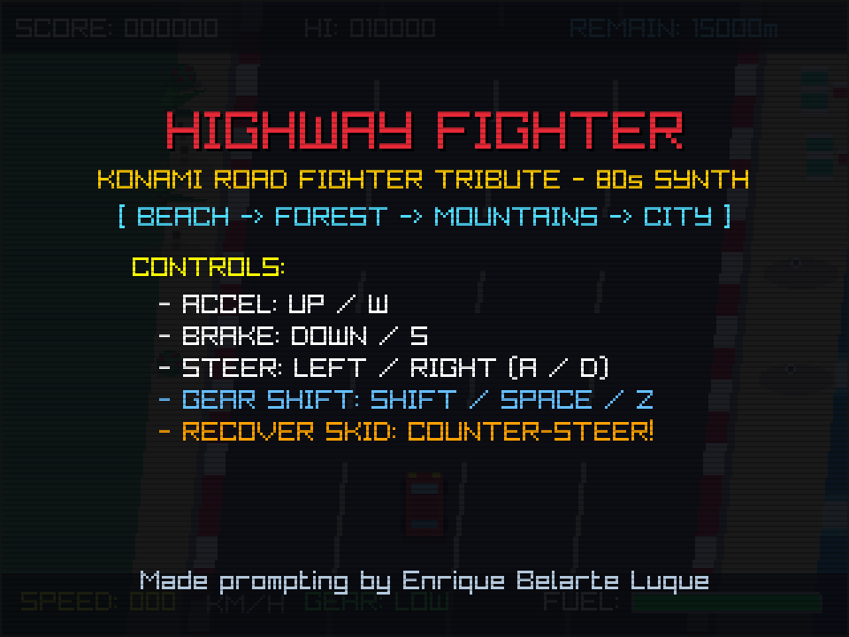
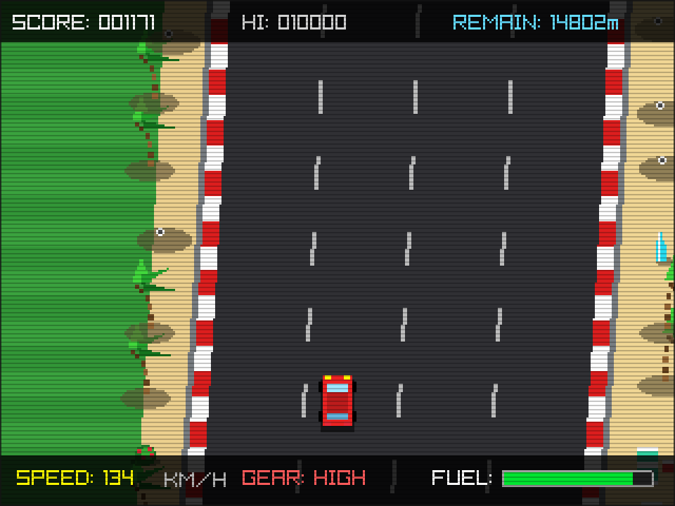
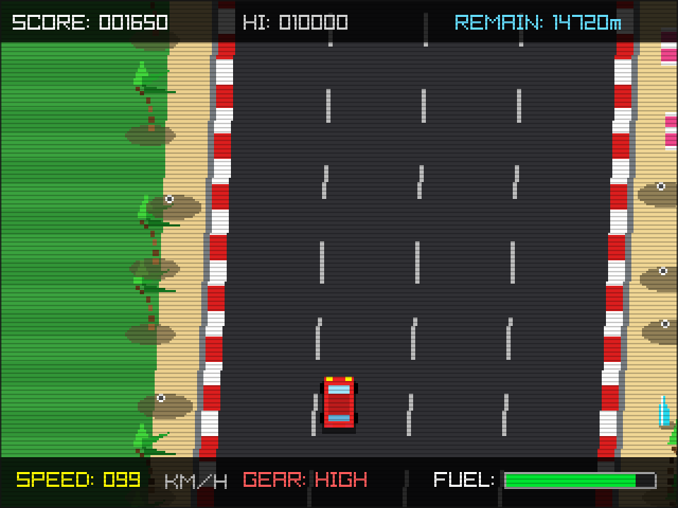

# Highway Fighter

A fast-paced, retro 2D arcade racing game built in C using [raylib](https://www.raylib.com/).

Highway Fighter is an homage to Konami's classic 1984 arcade and MSX/NES title **Road Fighter**. It recreates the adrenaline-pumping experience of top-down 80s highway racing, complete with dual-gear acceleration, fuel preservation, traffic weaving, and the iconic slide-and-counter-steer recovery mechanic.

---

## Screenshots

<p align="center">
  
  
</p>
<p align="center">
  
</p>

---

## Features

- **Classic 80s Arcade Action**: High-speed vertical scrolling inspired by Konami's *Road Fighter*.
- **2-Speed Transmission**: Low gear for initial acceleration (up to ~110 km/h) and High gear for top speed (up to ~220 km/h).
- **Iconic Counter-Steering Mechanic**: Bumping into traffic triggers a dangerous slide. Steer against the skid to regain control, or spin out into the guard rails!
- **Fuel Conservation & Pickups**: Your fuel drains as you drive—pick up fuel cars and bonus items along the road before running dry.
- **Dynamic Road & Traffic**: Multi-lane roads with curves, curbs, checkpoints, and various traffic behaviors.
- **Retro CRT Filter**: Toggle authentic scanline aesthetics on the fly.
- **Synthesized Audio**: Procedural sound effects for engine whine, tire skids, crashes, and fuel pickups.

---

## Controls

| Action | Primary Keys | Alternative Keys |
| :--- | :--- | :--- |
| **Steer Left / Right** | `Left` / `Right` Arrow | `A` / `D` |
| **Accelerate** | `Up` Arrow | `W` |
| **Brake / Decelerate** | `Down` Arrow | `S` |
| **Toggle Gear (Low / High)** | `Shift` (Left or Right) | `Space` / `Z` |
| **Direct Gear Select** | `1` (Low Gear) | `2` (High Gear) |
| **Start / Restart** | `Enter` / `Space` | `Z` |
| **Toggle CRT Scanlines** | `F1` | `C` |
| **Take Screenshot** | `F12` | `P` |
| **Quit Game** | `Escape` | Window Close |

> **Pro Tip (Counter-Steering)**: When you bump into another vehicle, your car will start sliding sideways. Steer immediately in the opposite direction of the slide to regain traction and avoid spinning out!

---

## Prerequisites & Installation

Highway Fighter requires a **C99 compiler** (`gcc` or `clang`), `make`, `pkg-config`, and the **raylib** library (version 4.x or 5.x).

Below are the commands to install the required packages on common Linux distributions:

### Debian / Ubuntu / Linux Mint / Pop!_OS

On modern Debian-based distributions (Debian 12+, Ubuntu 23.04+), raylib is available in the official repositories:

```bash
sudo apt update
sudo apt install build-essential pkg-config libraylib-dev
```

*(Note: On older Debian/Ubuntu releases without `libraylib-dev`, you can install raylib from the official PPA or build it from source with `libasound2-dev libgl1-mesa-dev libx11-dev libxrandr-dev libxi-dev libxinerama-dev libxcursor-dev`.)*

### Fedora / RHEL

On Fedora and compatible RPM-based distributions:

```bash
sudo dnf install gcc make pkgconf-pkg-config raylib-devel
```

### Arch Linux / Manjaro

On Arch Linux and derivatives:

```bash
sudo pacman -S base-devel raylib
```

---

## Building the Binary

### 1. Standard Build (Recommended)

Once dependencies are installed, navigate to the project directory and build using `make`:

```bash
make
```

To speed up compilation on multi-core CPUs:
```bash
make -j$(nproc)
```

The resulting binary `highway-fighter` will be generated in the root directory.

### 2. Build Options

- **Using a different compiler (e.g., Clang):**
  ```bash
  make CC=clang
  ```

- **Debug build (with symbols and no optimization):**
  ```bash
  make clean
  make CFLAGS="-std=c99 -g -O0 -Wall -Wextra"
  ```

- **Clean and recompile:**
  ```bash
  make clean && make
  ```

### 3. Direct Compilation Without Make

If you prefer compiling directly using `gcc` without `make`:

```bash
gcc -std=c99 -O2 src/*.c -Isrc $(pkg-config --cflags --libs raylib) -lm -o highway-fighter
```

---

## Running and Installing

### Running the Game

Launch the compiled executable directly:
```bash
./highway-fighter
```

Or build and run in one command:
```bash
make run
```

### Installing System-Wide (Optional)

To install the binary into `/usr/local/bin`:

```bash
sudo make install
```

To uninstall later:
```bash
sudo make uninstall
```

You can also install to a custom path (e.g., `~/.local/bin`):
```bash
make install PREFIX=$HOME/.local
```

---

## Troubleshooting

- **`Package raylib was not found in the pkg-config search path`**:
  Make sure you have installed the development package (`libraylib-dev` on Debian/Ubuntu, `raylib-devel` on Fedora, `raylib` on Arch).
  If you installed Raylib to a custom prefix such as `/usr/local`, add it to `PKG_CONFIG_PATH`:
  ```bash
  export PKG_CONFIG_PATH="/usr/local/lib/pkgconfig:$PKG_CONFIG_PATH"
  ```

- **`fatal error: raylib.h: No such file or directory`**:
  Verify your pkg-config output with:
  ```bash
  pkg-config --cflags raylib
  ```
  If raylib headers are located in a non-standard directory, you can pass them manually:
  ```bash
  make RAYLIB_CFLAGS="-I/path/to/raylib/include" RAYLIB_LIBS="-L/path/to/raylib/lib -lraylib -lm"
  ```

---

## Project Structure

```text
highway-fighter/
├── Makefile          # Build rules and compiler flags
├── README.md         # Project documentation
├── src/
│   ├── main.c        # Main loop and state machine
│   ├── game.h        # Shared structures, constants, and function prototypes
│   ├── player.c      # Player physics, acceleration, and counter-steer handling
│   ├── road.c        # Road curvature, track segments, and checkpoints
│   ├── traffic.c     # AI traffic vehicles and lane behavior
│   ├── items.c       # Fuel and bonus pickup items
│   ├── render.c      # Virtual resolution scaling and CRT rendering
│   ├── audio.c       # Procedural audio synthesis and sound effects
│   └── scenery.c     # Trackside decorations and backdrop elements
```

---

## Credits & Authors

- **Prompting & Game Design**: Enrique Belarte Luque
- **Original Tribute**: Homage to Konami's *Road Fighter* (1984)

---

## License

This project is open-source and intended as an educational tribute to Konami's *Road Fighter* (1984).
